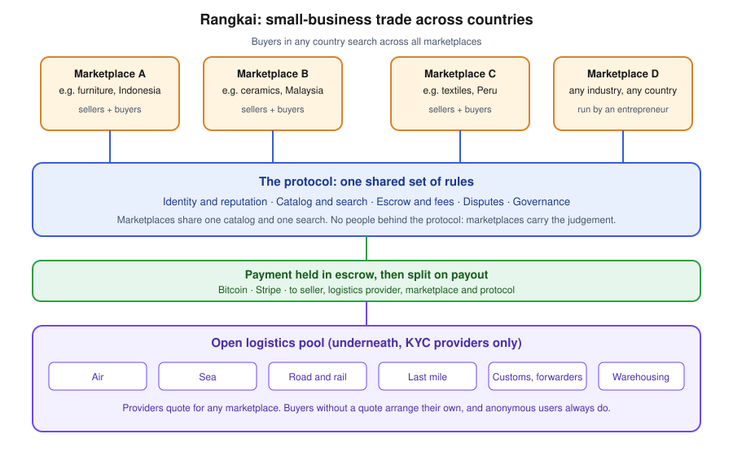

# Rangkai Protocol

An open protocol for small-business trade across borders. Anyone can build a marketplace for their own industry or country on it, and every marketplace trades with the others through shared identity, search, escrow, logistics and dispute rules.

Open source (MIT). No token. Bitcoin and card payments.



---

## Why

Around 90% of businesses in most countries are small, and almost none can sell abroad. Large platforms own the buyer, the payment, the shipping and the data. Rangkai separates the rules of trade from the marketplace:

- The **protocol** holds what every marketplace needs and none should own: identity, catalog and search, escrow, logistics, disputes.
- A **marketplace** is the face of it: a brand, a community, a country's rules. Marketplace entrepreneurs are responsible for compliance in their own country and rule on disputes.
- The protocol is designed to have **no people behind it, only rules**.

Read the short version in the [white paper](docs/whitepaper/whitepaper.md).

---

## How it works

| Who | What they do |
|---|---|
| Marketplace entrepreneurs | Run a marketplace, earn the marketplace fee (0 to 5%), rule on disputes |
| Sellers | List products, confirm orders, ship, get paid |
| Buyers | Search across marketplaces, pay into escrow, track, rate |
| Logistics providers | KYC only. Quote, ship, update tracking, get paid |

Sellers and buyers can use a **KYC**, **Nostr** or **anonymous** identity. Anonymous users arrange their own shipping.

**Money:** the buyer pays once. The money is held in escrow, then paid out to the seller and the logistics provider separately. The protocol takes 0.5% of the seller's payout and 0.5% of the logistics payout. It is never added to the buyer's price.

---

## The seven layers

| Layer | Purpose |
|---|---|
| 0 | Identity and reputation |
| 1 | Discovery and catalog, search |
| 2 | Transaction and settlement: escrow, fees, payouts |
| 3 | Logistics: an open pool of KYC providers |
| 4 | Trust and compliance: disputes, ratings, sanctions screening |
| 5 | Developer SDK and API |
| 6 | Governance: a council of 3 signers, 2 of 3 needed |

Details and the real status of each layer are in [docs/architecture/layers.md](docs/architecture/layers.md).

---

## What is in this repository

| Folder | What |
|---|---|
| `src/` | The protocol API (port 3000) and the core of layers 0, 1, 2, 3, 4 and 6 |
| `packages/sdk/` | `@rangkai/sdk`, the TypeScript client (layer 5) |
| `rangkai-marketplace/` | Reference marketplace for sellers and buyers (port 3001) |
| `logistics-marketplace/` | Marketplace for logistics providers (port 3002) |
| `scripts/` | Key generators, OpenAPI generator, test data |
| `docs/` | Architecture, white paper, API reference, working notes |

---

## Status

The protocol and a pilot marketplace run today, with Bitcoin on-chain and card escrow, a logistics marketplace, ratings and a governance council. This is pre-release software. Known gaps are listed in the open, in [docs/working/tech_debt.md](docs/working/tech_debt.md). The main ones:

- Search is simple text matching. Ranked full-text search is next.
- The marketplace fee is not yet collected at payout.
- Disputes are being rebuilt to the model in [payments_and_fees.md](docs/architecture/payments_and_fees.md).
- Identity uses email and password for KYC users. Key-based identity, Nostr login and chat are planned.
- Lightning is not yet supported.

---

## Run it locally

Requirements: Node.js, a Supabase project, and an `.env` file (start from `.env.example`).

```
npm install
npm run dev:api
```

The API listens on port 3000. Then, in other terminals:

```
cd packages/sdk
npm install
npm run build

cd ../../rangkai-marketplace
npm install
npm run dev
```

The marketplace runs on port 3001. `logistics-marketplace` is the same, on port 3002. To build your own marketplace, start from [docs/architecture/ref_client.md](docs/architecture/ref_client.md).

---

## Documentation

| Read | For |
|---|---|
| [docs/architecture/readme.md](docs/architecture/readme.md) | Start here: what is built, how it fits |
| [docs/architecture/payments_and_fees.md](docs/architecture/payments_and_fees.md) | Fees, escrow, order states, disputes |
| [docs/architecture/actors_and_trust.md](docs/architecture/actors_and_trust.md) | Who can do what, identity types, rules |
| [docs/architecture/logistics.md](docs/architecture/logistics.md) | The logistics pool |
| [docs/architecture/comms_and_nostr.md](docs/architecture/comms_and_nostr.md) | Messaging and Nostr |
| [docs/api/](docs/api/) | OpenAPI files and API references |
| [docs/working/](docs/working/) | Tech debt, operations notes, the latest session handover |

---

## How it compares

- **Alibaba** is a large B2B platform that owns the relationship between buyer and seller. On Rangkai, many independent marketplaces share one protocol, and a seller's identity and reputation travel with them.
- **Etsy** is built for handmade B2C goods on one platform. Rangkai is built for B2B trade between businesses, across marketplaces.
- **Shopify** ties a merchant to one platform. On Rangkai, a seller can be found through any marketplace on the protocol, and escrow and discovery are shared.

---

## Licence

MIT. See [LICENSE](LICENSE).