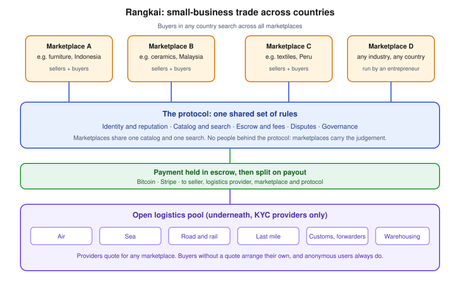
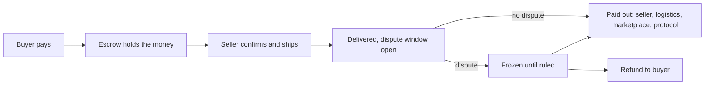

# Rangkai: An Open Protocol for Small-Business Trade

**White paper, draft 2 (November 2026).** Diagrams: `docs/architecture/diagrams/`.

---

## Abstract

Small businesses make most of the world's goods, and almost none of them can sell across a border. Large marketplaces own the buyer, the payment, the shipping and the data, so a small seller either joins and depends on them or stays local. Rangkai is an open protocol that lets anyone, an entrepreneur, a trade association or a cooperative, build a marketplace for their own industry or country, and have it trade with every other. Payment is held in escrow, shipping comes from a shared open pool, reputation travels with the seller, and no company sits in the middle. The protocol has no token. It is paid by a small fee on completed trades.

## 1. The problem

Around 90% of businesses in most countries are small. Four things keep them out of global trade:

1. **Payment.** Cross-border payment is slow and costly, and often closed to them.
2. **Shipping.** Freight is fragmented and priced for large shippers.
3. **Trust.** A buyer in Germany cannot judge a workshop in Malaysia.
4. **Visibility.** Without a platform, no buyer finds them. With one, the platform owns the relationship and can change the terms.

## 2. The idea

Separate the rules of trade from the marketplace. The **protocol** holds the parts every marketplace needs and none should own: identity, catalog and search, escrow, logistics, disputes. A **marketplace** is the face of it: a brand, a community, a country's rules. Many marketplaces share one protocol, so a buyer in one can find a seller in another.

*Figure 1. Global trade map: marketplaces in many countries on one protocol, with an open logistics pool underneath.*

The protocol is designed to have no people behind it, only rules. Anything that needs judgement belongs to a marketplace entrepreneur, who answers to their own country's law. This keeps the protocol neutral and keeps it from becoming the thing a government or a company can capture.

## 3. How it works

**People.** Marketplace entrepreneurs run marketplaces. Sellers list. Buyers order. Logistics providers quote and ship.

**Identity.** Three kinds, so that no one is shut out:
- *KYC* identity for registered businesses, checked by the marketplace under its national rules. Marketplaces, not the protocol, hold personal documents.
- *Nostr* identity, a key the user holds.
- *Anonymous* identity for people in places where open trade is dangerous or sanctioned. Anonymous users keep the same rules on prohibited goods, and arrange their own shipping.

**Reputation** belongs to the person, not the marketplace. It is calculated from completed trades, ratings and disputes, and the protocol signs it so any marketplace can verify it.

**Search.** Buyers search across all marketplaces by product, origin and where it ships to, in any language. The protocol owns the index, because search quality is what makes buyers come.

**Logistics.** A shared pool of KYC-verified providers (anonymous users are not served by the pool): air, sea, road, rail, last mile, forwarders, customs brokers and warehouses. Sellers attach quotes to products. Buyers choose at checkout, or bring their own.

**Payment.** The buyer pays once. Bitcoin and card payment are supported. The money is held in escrow until the order completes, then paid out to the seller and the logistics provider separately.

## 4. Money

Fees are small and always visible, and are taken from payouts, never added to what the buyer pays.

| Who | Fee | Taken from |
|---|---|---|
| Protocol | 0.5% | The seller's payout |
| Protocol | 0.5% | The logistics provider's payout |
| Marketplace | Set by the marketplace, 0% to 5% (2% suggested) | The seller's payout |

The protocol fee is the only income of the protocol. It pays for maintenance and nothing else. There is no token.

## 5. Disputes

Trade between businesses is mostly about whether goods arrived as agreed. The protocol keeps a closed list of grounds: not shipped, not delivered, not as agreed, wrong quantity, damaged in transit. The seller sets a window of 7, 14 or 30 days after delivery in which a buyer can object.

- **Facts decided by data.** Not shipped by the date, or not delivered according to tracking, is decided automatically.
- **Judgement decided by the marketplace.** Whether goods match the agreement is ruled on by the marketplace entrepreneur, with the reason on public record. The protocol then releases the money by rule.
- **Silence is not guilt.** A seller who does not answer has five days and several reminders before the case moves on.
- **Limits.** The protocol may freeze money only for five reasons: a sanctions match, payment fraud, a technical emergency, a marketplace that does not rule in time, or a ruling that breaks the rules. A freeze never moves money to the protocol or to any third party. Court orders are matters for the marketplace in its own jurisdiction.

**The aim is that the protocol resolves about 99% of disputes by itself, fairly and correctly.** Every ruling and its reason is recorded. Where rulings show a clear pattern, the protocol learns a rule from them, and a change to the rules goes through governance, never silently. Disputes with an anonymous party are decided by rule alone.

## 6. Governance

A small council of three signers, two needed to act, can change protocol settings and pause the protocol in a technical emergency. The number of signers can grow over time while the two-thirds rule holds. Everything else is an automatic rule. The aim is the way Bitcoin works: few levers, public rules, slow change.

## 7. Communications

Order messages run over a Nostr relay, in a room for each order, with an audit record that makes dispute evidence trustworthy. A party may hand its own copy of a conversation to the marketplace in a dispute, and the other party is told at once. The orders and money remain in the protocol's own database, so a relay failure never loses a trade.

## 8. Where it stands

The protocol and a pilot marketplace run today with escrow on Bitcoin and card, a logistics marketplace for providers, ratings, and a governance council. Still to be built or finished: search ranking and a ships-to filter, payment of the marketplace fee, the full dispute and freeze rules, moving personal data and passwords out of the protocol, key-based identity, and the Nostr rooms. The list is public in `docs/tech_debt.md`.

## 9. Roadmap

| Phase | Focus |
|---|---|
| 1 | One working corridor: pilot marketplace, search, escrow, shipping quotes, dispute rules |
| 2 | Nostr rooms, key-based identity, more marketplaces and logistics providers, rate estimates from pool data |
| 3 | Search across separate deployments, cryptographically verified governance, more signers |

## 10. Principles

Protocol first, platform optional. No token. Open source. Small fees, shown. Identity and reputation that the user owns. No one is excluded for where they live. The protocol does only what rules can do, and leaves judgement to people who answer for it.